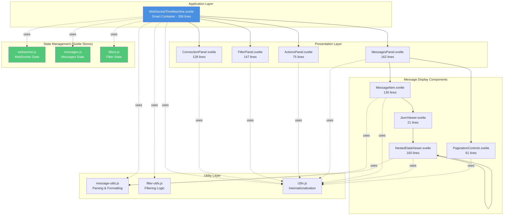
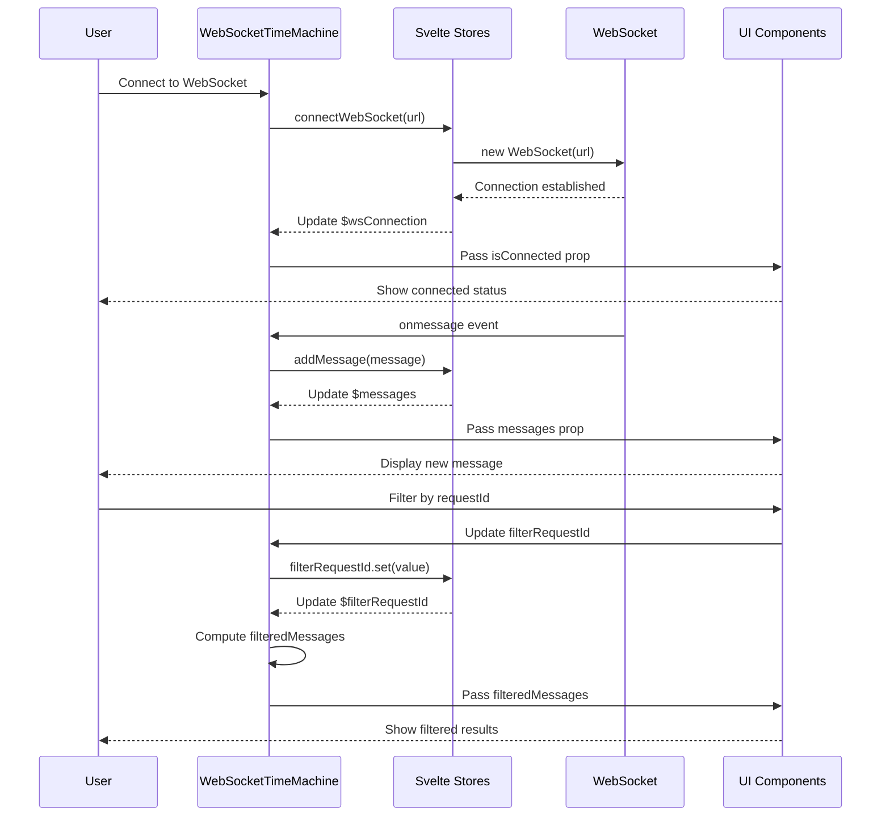
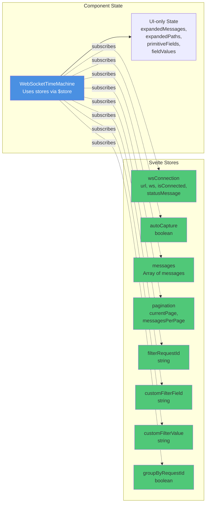
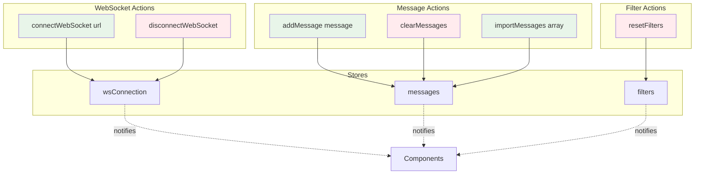
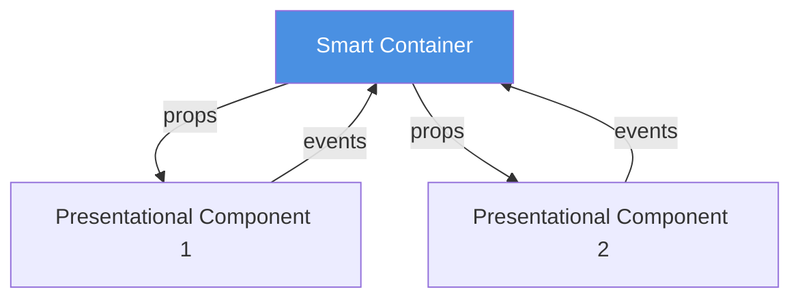
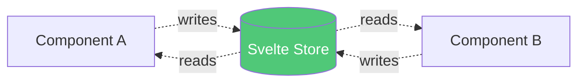
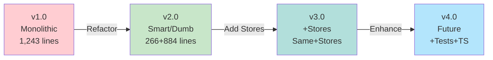

# Application Architecture

## Overview

This document provides a comprehensive overview of the WebSocketTimeMachine application architecture, including component structure, state management, and data flow.

## Architecture Diagram



## Data Flow Diagram



## State Management Architecture



## Component Hierarchy

```
WebSocketTimeMachine (Smart Container - 266 lines)
├── ConnectionPanel (Presentational - 128 lines)
│   └── WebSocket connection UI
├── CapturePanel (Inline - 10 lines)
│   └── Auto-capture checkbox
├── FilterPanel (Presentational - 147 lines)
│   ├── Request ID filter
│   ├── Custom field filter
│   └── Group by checkbox
├── ActionsPanel (Presentational - 75 lines)
│   ├── Export button
│   ├── Import button
│   └── Clear button
└── MessagesPanel (Coordinator - 162 lines)
    ├── PaginationControls (Presentational - 61 lines)
    ├── MessagesList OR GroupedMessages
    └── MessageItem (Presentational - 130 lines)
        └── JsonViewer (Presentational - 21 lines)
            └── NestedDataViewer (Recursive - 160 lines)
```

## Store Actions Flow



## Key Design Patterns

### 1. Smart/Dumb Component Pattern

**Smart Component (Container):**
- `WebSocketTimeMachine.svelte`
- Manages application state via stores
- Contains business logic
- Coordinates between child components
- Handles side effects (WebSocket, file I/O)

**Dumb Components (Presentational):**
- `ConnectionPanel`, `FilterPanel`, `ActionsPanel`, etc.
- Pure UI components
- Receive data via props
- Emit events for user actions
- No business logic
- Highly reusable

### 2. Store Pattern

**Centralized State:**
- All application state in Svelte stores
- Single source of truth
- Reactive updates via `$store` syntax

**Store Actions:**
- Encapsulate state mutations
- Handle complex logic
- Provide clean API

### 3. Reactive Collections

**Using Svelte 5 `$state()`:**
```javascript
let expandedMessages = $state(new Set());
let expandedPaths = $state(new Map());
```

- Automatic reactivity
- No manual reassignment needed
- Works with built-in Map and Set

## Component Communication

### Props Down, Events Up



### Store-based Communication



## File Structure

```
src/
├── WebSocketTimeMachine.svelte          # Smart container (266 lines)
├── main.js                               # Entry point
├── lib/
│   ├── components/
│   │   ├── connection/
│   │   │   └── ConnectionPanel.svelte    # 128 lines
│   │   ├── filters/
│   │   │   └── FilterPanel.svelte        # 147 lines
│   │   ├── actions/
│   │   │   └── ActionsPanel.svelte       # 75 lines
│   │   └── messages/
│   │       ├── MessagesPanel.svelte      # 162 lines
│   │       ├── MessageItem.svelte        # 130 lines
│   │       ├── JsonViewer.svelte         # 21 lines
│   │       ├── NestedDataViewer.svelte   # 160 lines
│   │       └── PaginationControls.svelte # 61 lines
│   ├── stores/
│   │   ├── websocket.js                  # WebSocket state
│   │   ├── messages.js                   # Messages state
│   │   └── filters.js                    # Filter state
│   └── utils/
│       ├── message-utils.js              # Message parsing
│       ├── filter-utils.js               # Filtering logic
│       └── i18n.js                       # Internationalization
└── __tests__/                            # Future: Test files
```

## Performance Considerations

### Optimization Strategies

1. **Pagination** - Display 50 messages per page
2. **Lazy Parsing** - Parse JSON only when needed
3. **Derived Stores** - Memoize computed values
4. **Granular Components** - Update only what changed
5. **Reactive Collections** - Automatic change detection

### Bundle Size

| Build | Size | Gzipped | Notes |
|-------|------|---------|-------|
| ESM | 126.24 KB | 34.27 KB | Modern bundler target |
| UMD | 76.67 KB | 26.35 KB | Universal module |

## Security Considerations

### XSS Prevention

- No `@html` usage (prevents XSS)
- User input sanitized before display
- JSON parsing with error handling

### WebSocket Security

- User provides WebSocket URL
- No automatic connection
- Connection status clearly displayed
- Disconnect functionality available

## Testing Strategy

### Unit Tests

**Utility Functions:**
- `parseMessageData()`
- `formatValue()`
- `filterByCustomField()`
- `getAllFieldPaths()`

**Store Actions:**
- `connectWebSocket()`
- `addMessage()`
- `clearMessages()`
- `resetFilters()`

### Component Tests

**Presentational Components:**
- Props render correctly
- Events emit properly
- UI interactions work

**Integration Tests:**
- Store updates propagate
- Component communication works
- Full workflows complete

## Future Enhancements

### Planned Improvements

1. **Testing** - Add comprehensive test suite
2. **TypeScript** - Add type safety
3. **Virtual Scrolling** - Handle 10,000+ messages
4. **Persistence** - Save to localStorage
5. **Export Formats** - CSV, XML support
6. **Themes** - Dark mode support
7. **Accessibility** - ARIA labels, keyboard navigation

### Architectural Evolution



## Code Metrics

### Current State

| Metric | Value |
|--------|-------|
| Total Components | 9 |
| Smart Components | 1 |
| Presentational Components | 8 |
| Stores | 3 |
| Utilities | 3 |
| Total Lines (Components) | 1,150 |
| Main Component Lines | 266 |
| Average Component Size | 128 lines |
| ESLint Warnings | 4 (false positives) |

### Improvement from v1.0

| Metric | Before | After | Change |
|--------|--------|-------|--------|
| Main Component | 1,243 lines | 266 lines | -78.6% |
| ESLint Errors | 17 | 4 | -76.5% |
| Test Coverage | 0% | 0% | TBD |
| Maintainability | Low | High | ✅ |

## Conclusion

The application follows modern Svelte 5 patterns with:
- ✅ Smart/dumb component architecture
- ✅ Centralized state management with stores
- ✅ Reactive collections with `$state()`
- ✅ Clean separation of concerns
- ✅ Highly testable architecture
- ✅ Excellent maintainability

---

**Version**: 3.0  
**Last Updated**: 2026-01-03  
**Status**: ✅ Production Ready
