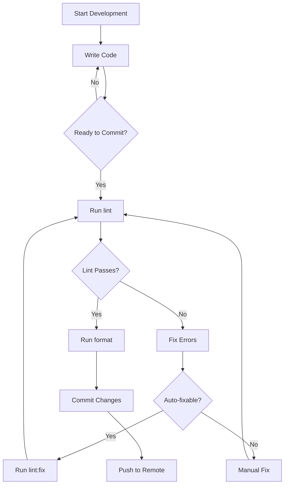
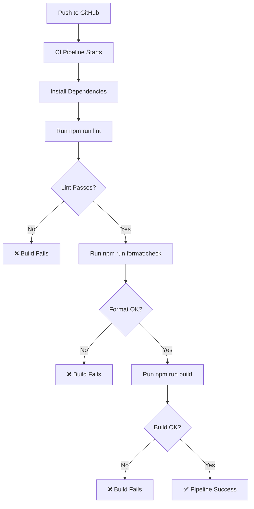
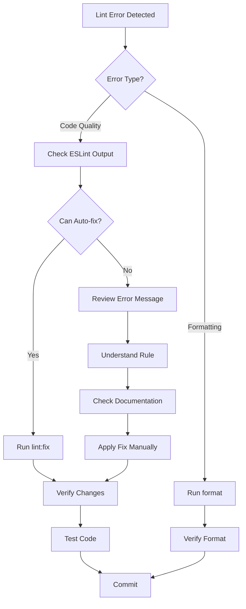
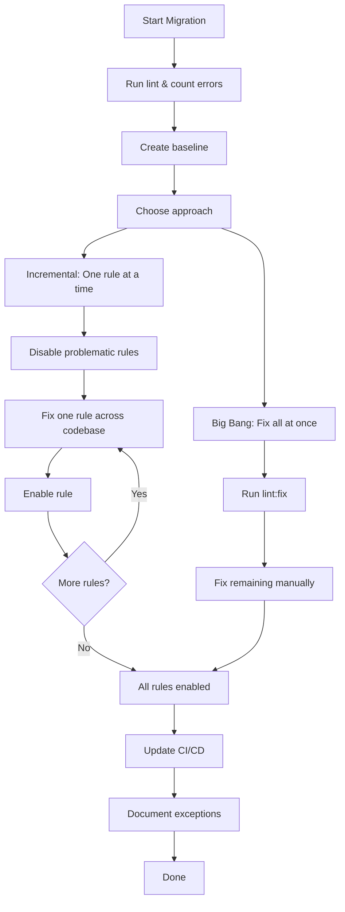

# Linting and Formatting Guide

This guide explains the linting and formatting setup for the time-machine-poc project, including workflows, best practices, and how to resolve common issues.

## Overview

The project uses two tools for code quality:
- **ESLint**: Static code analysis for JavaScript/Svelte
- **Prettier**: Code formatting

## Configuration Files

### ESLint Configuration
- **File**: `eslint.config.js`
- **Format**: ESLint 9 flat config (modern format)
- **Extends**: 
  - `@eslint/js` recommended rules
  - `eslint-plugin-svelte` for Svelte-specific rules
  - `eslint-config-prettier` for compatibility

### Prettier Configuration
- **File**: `.prettierrc`
- **Key Settings**:
  - Single quotes
  - Semicolons
  - 100 character line width
  - 2-space indentation
  - Svelte plugin for `.svelte` files

### Ignore Files
- **ESLint**: Configured in `eslint.config.js` (ignores section)
- **Prettier**: `.prettierignore`

## Workflows

### Development Workflow



### CI/CD Integration Workflow



### Fixing Linting Issues Workflow



## Available Commands

### Linting Commands

```bash
# Check for linting errors
npm run lint

# Auto-fix linting errors (where possible)
npm run lint:fix

# Lint specific files
npx eslint src/WebSocketTimeMachine.svelte
```

### Formatting Commands

```bash
# Check code formatting
npm run format:check

# Auto-format all files
npm run format

# Format specific files
npx prettier --write src/WebSocketTimeMachine.svelte
```

## Strict Rules Enforced

### ESLint Rules (46+ strict rules)

#### Code Quality Rules
- `no-var`: Use `let`/`const` instead of `var`
- `prefer-const`: Use `const` for variables that aren't reassigned
- `prefer-template`: Use template literals instead of string concatenation
- `eqeqeq`: Always use `===` and `!==` (strict equality)
- `no-unused-vars`: No unused variables or function parameters

#### Safety Rules
- `no-eval`: Prevent use of `eval()`
- `no-debugger`: No debugger statements in production
- `no-alert`: No `alert()`, `confirm()`, or `prompt()`
- `require-await`: Async functions must use `await`
- `no-param-reassign`: Don't modify function parameters

#### Modern JavaScript Rules
- `prefer-arrow-callback`: Use arrow functions for callbacks
- `prefer-spread`: Use spread operator instead of `.apply()`
- `prefer-destructuring`: Use destructuring for objects
- `object-shorthand`: Use shorthand object properties
- `no-duplicate-imports`: Combine imports from same module

#### Svelte-Specific Rules
- `svelte/require-each-key`: Each blocks must have a key
- `svelte/no-at-html-tags`: Use `@html` directive carefully
- `svelte/no-reactive-reassign`: Don't reassign reactive declarations
- `svelte/prefer-svelte-reactivity`: Use Svelte reactive constructs

### Prettier Rules

- **Quotes**: Single quotes for strings
- **Semicolons**: Always required
- **Trailing Commas**: ES5 style (objects, arrays)
- **Tab Width**: 2 spaces
- **Line Width**: 100 characters
- **Arrow Parens**: Always use parentheses
- **End of Line**: LF (Unix style)

## Svelte 5 Specific Considerations

### Runes and Reactivity

Svelte 5 introduces runes (`$state`, `$derived`, `$effect`) that require special handling:

```javascript
// Svelte 5 runes use 'let' even when not reassigned
let count = $state(0);        // Must use 'let'
let doubled = $derived(count * 2);  // Must use 'let'
```

**Configuration**: `prefer-const` is disabled in `.svelte` files to accommodate this.

## Common Issues and Solutions

### Issue 1: "Unnecessary 'else' after 'return'"

**Problem**: ESLint flags unnecessary else blocks after return statements.

```javascript
// ❌ Bad
if (condition) {
  return value;
} else {
  return otherValue;
}

// ✅ Good
if (condition) {
  return value;
}
return otherValue;
```

### Issue 2: "Each block should have a key"

**Problem**: Svelte `{#each}` blocks need keys for proper reactivity.

```svelte
<!-- ❌ Bad -->
{#each items as item}
  <div>{item.name}</div>
{/each}

<!-- ✅ Good -->
{#each items as item (item.id)}
  <div>{item.name}</div>
{/each}
```

### Issue 3: "Unexpected string concatenation"

**Problem**: Using `+` for string concatenation instead of template literals.

```javascript
// ❌ Bad
const message = 'Hello ' + name;

// ✅ Good
const message = `Hello ${name}`;
```

### Issue 4: "Unused variable"

**Problem**: Variables or parameters defined but never used.

```javascript
// ❌ Bad
function handleClick(event) {
  // event is not used
  doSomething();
}

// ✅ Good - prefix with underscore to indicate intentionally unused
function handleClick(_event) {
  doSomething();
}
```

## Integration with CI/CD

### GitHub Actions Example

```yaml
name: Lint and Format Check

on: [push, pull_request]

jobs:
  quality:
    runs-on: ubuntu-latest
    steps:
      - uses: actions/checkout@v3
      - uses: actions/setup-node@v3
        with:
          node-version: '18'
      - run: npm ci
      - run: npm run lint
      - run: npm run format:check
      - run: npm run build
```

### Pre-commit Hook (Optional)

To automatically lint before each commit, install husky:

```bash
npm install --save-dev husky lint-staged
npx husky init
```

Add to `package.json`:

```json
{
  "lint-staged": {
    "*.{js,svelte}": ["eslint --fix", "prettier --write"],
    "*.{json,md,html,css}": ["prettier --write"]
  }
}
```

## Best Practices

### 1. Fix Issues Incrementally
- Don't ignore all errors at once
- Fix one rule at a time across the codebase
- Gradually increase strictness

### 2. Use Auto-fix When Possible
```bash
# Fix most issues automatically
npm run lint:fix && npm run format
```

### 3. Understand Before Disabling Rules
- Read the rule documentation
- Understand why it's triggered
- Only disable if truly necessary

### 4. Keep Configurations Updated
- Review ESLint/Prettier releases
- Update plugins regularly
- Test configuration changes

### 5. Document Exceptions
```javascript
// eslint-disable-next-line no-console -- Debugging production issue #123
console.log('Debug info:', data);
```

## Configuration Decision Log

### Why These Specific Settings?

1. **Single Quotes**: Industry standard for JavaScript, more readable
2. **100 Character Line Width**: Balance between readability and screen real estate
3. **Semicolons Required**: Prevents ASI (Automatic Semicolon Insertion) bugs
4. **Strict Equality**: Prevents type coercion bugs
5. **No Console in Production**: Ensures clean production logs

### Svelte 5 Adaptations

- Disabled `prefer-const` in `.svelte` files for runes
- Allowed `$`-prefixed variables in unused variable checks
- Enabled Svelte-specific reactivity rules

## Troubleshooting

### ESLint Not Running
```bash
# Verify installation
npm list eslint

# Reinstall if needed
npm install
```

### Prettier Not Formatting Svelte Files
```bash
# Check plugin installation
npm list prettier-plugin-svelte

# Ensure .prettierrc includes plugin
```

### Conflicting Rules
- ESLint and Prettier conflicts are resolved by `eslint-config-prettier`
- This config disables conflicting ESLint rules
- Always format with Prettier AFTER linting

## Resources

- [ESLint Documentation](https://eslint.org/docs/latest/)
- [Prettier Documentation](https://prettier.io/docs/en/)
- [eslint-plugin-svelte](https://sveltejs.github.io/eslint-plugin-svelte/)
- [Svelte 5 Runes](https://svelte-5-preview.vercel.app/docs/runes)

## Migration Guide

### For Existing Code

If you're adding this to existing code with many violations:



### Step-by-Step for New Rules

1. **Baseline**: `npm run lint > baseline.txt`
2. **Auto-fix**: `npm run lint:fix`
3. **Review changes**: `git diff`
4. **Manual fixes**: Address remaining errors
5. **Test**: `npm run build && npm test`
6. **Commit**: Commit linting changes separately

---

**Last Updated**: 2026-01-03
**Maintainer**: Development Team
