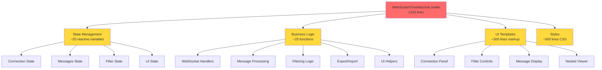
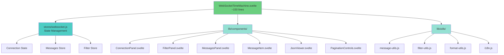
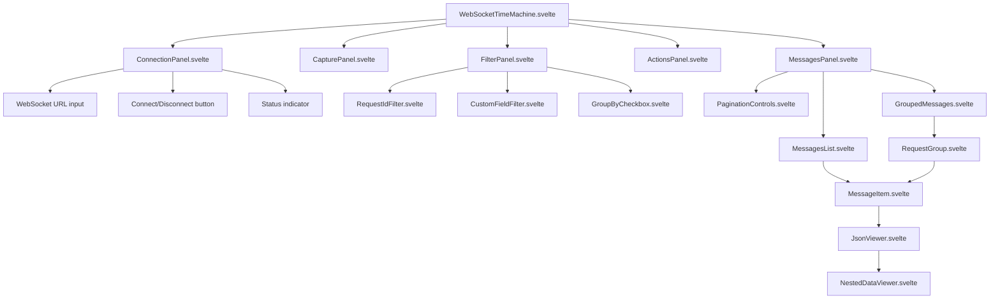
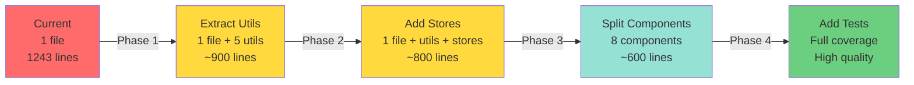

# Svelte Component Analysis: WebSocketTimeMachine.svelte

## Overview

**File**: `src/WebSocketTimeMachine.svelte`  
**Size**: 1,243 lines  
**Type**: Single-file Svelte 5 component  

This document provides a comprehensive analysis of the WebSocketTimeMachine component, identifying pitfalls, code quality issues, and proposing a refactored component structure.

## Architecture Analysis

### Current Structure



### Proposed Refactored Structure



## Identified Pitfalls

### 1. 🔴 Monolithic Component (Critical)

**Issue**: Single 1,243-line file violates separation of concerns

**Impact**:
- Difficult to maintain and test
- Hard to reuse parts of functionality
- Performance: entire component re-renders on any state change
- Team collaboration bottleneck

**Location**: Entire file

**Solution**: Split into smaller, focused components (see refactoring plan below)

---

### 2. 🔴 Missing Keys in {#each} Blocks (Critical)

**Issue**: Multiple {#each} blocks lack keys, causing potential rendering bugs

**Impact**:
- Incorrect DOM updates during list changes
- Loss of component state during reordering
- Performance degradation

**Locations**:
- Line 431: `{#each data as item, index}`
- Line 465: `{#each Object.entries(data) as [key, value]}`
- Line 571: `{#each availableFields as field}`
- Line 589: `{#each availableValues as value}`
- Line 630: `{#each [...groupedMessages.entries()] as [requestId, msgs]}`
- Line 637: `{#each msgs as message, index}`
- Line 702: `{#each visibleMessages as message, index}`

**ESLint Error**: `svelte/require-each-key`

**Solution**:
```svelte
<!-- Before -->
{#each data as item, index}

<!-- After -->
{#each data as item, index (index)}
<!-- Or better with unique ID -->
{#each messages as message (message.timestamp + message.type)}
```

---

### 3. 🟡 Unused Variables (Medium)

**Issue**: Several unused variables and function parameters

**Impact**:
- Code clutter
- Confusion about intent
- Potential bugs from incomplete features

**Locations**:
- Line 341: `error` parameter in `ws.onerror` handler
- Line 397: `error` parameter in import error handler
- Line 405: `goToPage` function defined but never used

**Solution**: 
```javascript
// Prefix with underscore to indicate intentionally unused
ws.onerror = (_error) => {
  statusMessage = 'Ошибка WebSocket соединения';
};

// Or remove if truly not needed
// Delete goToPage function if pagination doesn't need direct page access
```

---

### 4. 🟡 String Concatenation Instead of Template Literals (Medium)

**Issue**: Using `+` for string concatenation

**Impact**:
- Less readable code
- Harder to maintain
- Not following modern JavaScript best practices

**Locations**:
- Line 319: `statusMessage = 'Подключено к ' + wsUrl;`
- Line 350: `statusMessage = 'Ошибка подключения: ' + error.message;`

**Solution**:
```javascript
// Before
statusMessage = 'Подключено к ' + wsUrl;

// After
statusMessage = `Подключено к ${wsUrl}`;
```

---

### 5. 🟡 Unnecessary else After return (Medium)

**Issue**: `else` block after `return` statement

**Impact**:
- Unnecessary nesting
- Reduced readability

**Location**: Line 92 in `pluralizeRussian` function

**Solution**:
```javascript
// Before
if (mod10 === 1 && mod100 !== 11) {
  return one;
} else if (mod10 >= 2 && mod10 <= 4 && (mod100 < 10 || mod100 >= 20)) {
  return few;
} else {
  return many;
}

// After
if (mod10 === 1 && mod100 !== 11) {
  return one;
}
if (mod10 >= 2 && mod10 <= 4 && (mod100 < 10 || mod100 >= 20)) {
  return few;
}
return many;
```

---

### 6. 🟡 Using Built-in Set/Map Instead of SvelteSet/SvelteMap (Medium)

**Issue**: Using standard JavaScript `Set` and `Map` for reactive data

**Impact**:
- Manual reactivity triggers required (`expandedMessages = expandedMessages`)
- More error-prone
- Svelte 5 provides reactive alternatives

**Locations**:
- Line 153: `const primFields = new Set();`
- Line 154: `const valuesMap = new Map();`
- Line 155: `let expandedNestedPaths = $state(new Map());`
- Line 296: `const groups = new Map();`

**Note**: This may be a false positive if Svelte 5 doesn't require `SvelteSet`/`SvelteMap` when wrapped in `$state()`

**Solution**: Investigate Svelte 5 docs, or manually trigger reactivity as currently done

---

### 7. 🟢 No Component Tests (Low Priority)

**Issue**: No unit or integration tests for component logic

**Impact**:
- Regression risk when refactoring
- No validation of business logic
- Harder to onboard new developers

**Solution**: Add Vitest + Testing Library tests (addressed in refactoring plan)

---

### 8. 🟢 Hardcoded Russian Text (Low Priority)

**Issue**: All UI text is in Russian, hardcoded in component

**Impact**:
- Not internationalized
- Hard to support multiple languages
- Violates separation of concerns (UI logic + translations)

**Locations**: Throughout the file (70+ instances)

**Solution**: Extract to i18n file (see refactoring plan)

---

### 9. 🟢 Magic Numbers (Low Priority)

**Issue**: Hardcoded values without named constants

**Locations**:
- Line 19: `messagesPerPage = $state(50)`
- Line 750: `--json-viewer-max-height: 400px`
- Line 1013: `.messages-list { max-height: 400px; }`

**Solution**:
```javascript
// Create constants
const DEFAULT_MESSAGES_PER_PAGE = 50;
const JSON_VIEWER_MAX_HEIGHT = 400;

let messagesPerPage = $state(DEFAULT_MESSAGES_PER_PAGE);
```

---

### 10. 🟢 Mixed Responsibilities in Functions (Low Priority)

**Issue**: Some functions do multiple things

**Example**: `getAllFieldPaths` (line 152)
- Extracts field paths
- Updates global state (`primitiveFields`, `fieldValues`)
- Returns sorted array

**Impact**:
- Harder to test
- Side effects not obvious
- Violates single responsibility principle

**Solution**: Split into pure functions + state updates

---

## Performance Considerations

### Current Performance Optimizations ✅

1. **Pagination**: Messages displayed in pages of 50 ✅
2. **Push over spread**: Using `messages.push()` instead of `[...messages]` ✅
3. **Lazy parsing**: `parseMessageData` only called when needed ✅
4. **Derived computations**: Using `$derived` for filtering ✅

### Potential Performance Issues ⚠️

1. **Large Message Lists**: 
   - Filtering runs on every state change
   - Consider virtual scrolling for 10,000+ messages

2. **Nested Data Expansion**:
   - Deep object traversal on every render
   - Could memoize parsed results

3. **No Debouncing**:
   - Filter inputs trigger immediate re-renders
   - Add debounce for text inputs

---

## Proposed Refactoring Plan

### Phase 1: Extract Utilities (No UI Changes)

**Goal**: Move pure functions to separate modules

```
src/
  lib/
    utils/
      message-utils.js      # parseMessageData, formatValue, etc.
      filter-utils.js       # filterByCustomField, getNestedValue
      format-utils.js       # pluralizeRussian, getValueType
      field-utils.js        # getAllFieldPaths, extractFieldPaths
      i18n.js              # All Russian text → translations object
```

**Benefits**:
- Easier to test
- Reusable across components
- No UI changes = low risk

---

### Phase 2: Extract State Management

**Goal**: Move state to Svelte stores

```javascript
// stores/websocket.js
import { writable, derived } from 'svelte/store';

export const wsConnection = writable({
  url: '',
  connected: false,
  status: ''
});

export const messages = writable([]);

export const filters = writable({
  requestId: '',
  customField: '',
  customValue: '',
  groupByRequestId: false
});

export const filteredMessages = derived(
  [messages, filters],
  ([$messages, $filters]) => {
    // Filtering logic here
  }
);
```

**Benefits**:
- Centralized state management
- Easier to persist/restore state
- Better DevTools support

---

### Phase 3: Extract UI Components

#### Component Breakdown



#### Component Specifications

**1. ConnectionPanel.svelte** (~80 lines)
- Props: `url`, `connected`, `status`
- Events: `connect`, `disconnect`
- Responsibilities: WebSocket connection UI

**2. FilterPanel.svelte** (~120 lines)
- Props: `requestIdFilter`, `customField`, `customValue`, etc.
- Events: `filterChange`
- Components: RequestIdFilter, CustomFieldFilter

**3. MessagesPanel.svelte** (~150 lines)
- Props: `messages`, `filters`, `pagination`
- Responsibilities: Render messages or grouped view
- Components: MessagesList, GroupedMessages, PaginationControls

**4. MessageItem.svelte** (~60 lines)
- Props: `message`, `index`, `expanded`
- Events: `toggleExpand`
- Components: JsonViewer

**5. JsonViewer.svelte** (~100 lines)
- Props: `data`, `messageIndex`
- Current: `nestedDataViewer` snippet
- Convert to recursive component

**6. PaginationControls.svelte** (~40 lines)
- Props: `currentPage`, `totalPages`, `pageInfo`
- Events: `pageChange`, `next`, `prev`, `last`

---

### Phase 4: Add Tests

```javascript
// __tests__/message-utils.test.js
import { describe, it, expect } from 'vitest';
import { parseMessageData, formatValue } from '../lib/utils/message-utils';

describe('parseMessageData', () => {
  it('should parse JSON string', () => {
    const msg = { data: '{"key": "value"}' };
    expect(parseMessageData(msg)).toEqual({ key: 'value' });
  });
  
  it('should return null for invalid JSON', () => {
    const msg = { data: 'invalid' };
    expect(parseMessageData(msg)).toBeNull();
  });
});
```

---

## Migration Path Diagram



---

## Recommended Component Structure

```
src/
  WebSocketTimeMachine.svelte          # Main component (150 lines)
  lib/
    components/
      connection/
        ConnectionPanel.svelte          # 80 lines
        StatusIndicator.svelte          # 30 lines
      filters/
        FilterPanel.svelte              # 120 lines
        RequestIdFilter.svelte          # 50 lines
        CustomFieldFilter.svelte        # 70 lines
      messages/
        MessagesPanel.svelte            # 150 lines
        MessagesList.svelte             # 80 lines
        GroupedMessages.svelte          # 100 lines
        MessageItem.svelte              # 60 lines
        PaginationControls.svelte       # 40 lines
      viewer/
        JsonViewer.svelte               # 100 lines
        NestedDataViewer.svelte         # 80 lines
      actions/
        ActionsPanel.svelte             # 60 lines
        CapturePanel.svelte             # 40 lines
    stores/
      websocket.js                      # WebSocket state store
      messages.js                       # Messages store
      filters.js                        # Filter state store
      ui.js                            # UI state (pagination, expansion)
    utils/
      message-utils.js                  # Message parsing/formatting
      filter-utils.js                   # Filtering logic
      format-utils.js                   # Value formatting
      field-utils.js                    # Field path extraction
      i18n.js                          # Internationalization
  __tests__/
    utils/
      message-utils.test.js
      filter-utils.test.js
      format-utils.test.js
    components/
      MessageItem.test.js
      JsonViewer.test.js
```

---

## Priority Recommendations

### Immediate (Week 1)

1. ✅ Fix all ESLint errors:
   - Add keys to {#each} blocks
   - Fix string concatenation
   - Remove unused variables
   - Fix else-after-return

2. ✅ Extract utilities (Phase 1):
   - Move pure functions to separate files
   - No UI changes = safe refactor

### Short-term (Weeks 2-3)

3. 🔧 Extract state management (Phase 2):
   - Create Svelte stores
   - Migrate state gradually

4. 🔧 Split into 3-5 major components (Phase 3 partial):
   - ConnectionPanel
   - FilterPanel
   - MessagesPanel
   - Start with least risky

### Medium-term (Month 2)

5. 📊 Complete component split (Phase 3):
   - All 8 components extracted
   - JsonViewer converted to component

6. 🧪 Add tests (Phase 4):
   - Unit tests for utilities
   - Component tests for major components

---

## Testing Strategy

### Unit Tests (Utilities)
```javascript
// Test pure functions
- parseMessageData()
- formatValue()
- filterByCustomField()
- getAllFieldPaths()
- pluralizeRussian()
```

### Component Tests
```javascript
// Test component behavior
- MessageItem renders correctly
- JsonViewer expands/collapses
- PaginationControls changes pages
- FilterPanel applies filters
```

### Integration Tests
```javascript
// Test full workflows
- Connect → Capture → Export
- Import → Filter → View
- Paginate through messages
```

---

## Risk Assessment

| Refactoring Phase | Risk | Effort | Impact |
|------------------|------|--------|--------|
| Fix ESLint errors | 🟢 Low | Small | High |
| Extract utilities | 🟢 Low | Medium | High |
| Add stores | 🟡 Medium | Medium | High |
| Split components | 🟡 Medium | Large | Very High |
| Add tests | 🟢 Low | Large | High |

---

## Benefits of Refactoring

### Code Quality
- ✅ Easier to read and understand
- ✅ Better separation of concerns
- ✅ Follows Svelte 5 best practices
- ✅ Testable architecture

### Maintainability
- ✅ Smaller files = easier to navigate
- ✅ Reusable components
- ✅ Clear dependencies
- ✅ Better team collaboration

### Performance
- ✅ Smaller components = better granular updates
- ✅ Can optimize individual components
- ✅ Easier to add virtual scrolling
- ✅ Better code splitting

### Developer Experience
- ✅ Faster iteration
- ✅ Better IDE support
- ✅ Easier debugging
- ✅ Clear component boundaries

---

## Next Steps

1. **Review this analysis** with the team
2. **Prioritize pitfalls** to fix first
3. **Choose refactoring approach**:
   - Option A: Big bang (rewrite in one go)
   - Option B: Incremental (recommended)
4. **Create tasks** for each phase
5. **Set milestones** and track progress

---

**Document Version**: 1.0  
**Date**: 2026-01-03  
**Status**: Proposal  
**Author**: Analysis Bot
